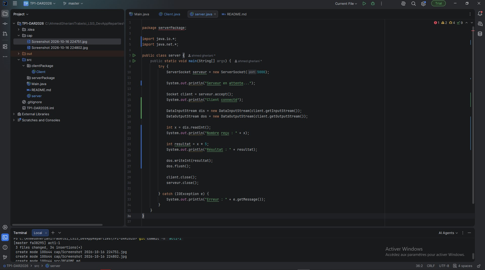
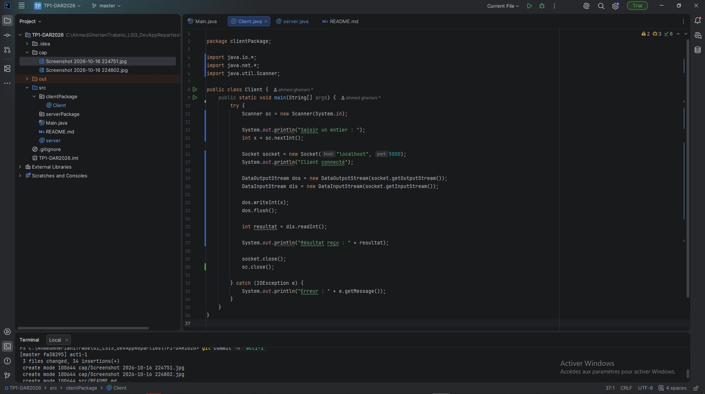

# TP1 — Les sockets TCgit P en Java

**Matière :** Développement d'applications réparties  
**Classe :** LSI 3  
**Projet :** TP1-DAR2026

## Objectif
L'objectif de ce TP est de réaliser une première communication Client/Serveur en Java en utilisant les sockets TCP.

## 1. Préparation de l'environnement
Nous avons vérifié l'installation de Git avec `git --version` et celle de Java avec `java --version`.

## 2. Création du serveur
Nous avons créé une classe `Server` dans le package `serverPackage`. Le serveur écoute sur le port 5000 et attend une connexion grâce à la méthode `accept()`.

## 3. Création du client
Nous avons créé une classe `Client` dans le package `clientPackage`. Le client utilise une socket pour se connecter au serveur.

## 4. Résultat
Après le lancement du serveur, celui-ci reste en attente. Lorsque le client démarre, la connexion TCP est établie et les deux programmes affichent leurs messages de confirmation.

## 5. Test avec une adresse IP
Nous avons remplacé `localhost` par l'adresse IPv4 de l'ordinateur pour tester la connexion.

## Conclusion
Ce TP nous a permis de comprendre le fonctionnement de base de la communication Client/Serveur avec les sockets TCP en Java.

# TP1 — Activité 1-2 : Service de calculatrice

**Matière :** Développement d'applications réparties  
**Classe :** LSI 3  
**Projet :** TP1-DAR2026

## 1. Objectif

L'objectif de cette activité est de développer un service de calculatrice utilisant une communication Client/Serveur avec les sockets TCP en Java.

Le client envoie un entier au serveur, qui effectue une multiplication par 5 et renvoie le résultat.

## 2. Création du serveur

Nous avons modifié la classe `Server` pour recevoir un entier à l'aide de `DataInputStream`, effectuer le calcul et envoyer le résultat avec `DataOutputStream`.

## 3. Création du client

Nous avons modifié la classe `Client` pour permettre la saisie d'un entier au clavier, son envoi au serveur et l'affichage du résultat reçu.

# TP1 — Activité 1-3 : Amélioration du service de calculatrice

**Matière :** Développement d'applications réparties  
**Classe :** LSI 3  
**Projet :** TP1-DAR2026

## 1. Objectif

L'objectif de cette activité est d'améliorer l'application Client/Serveur TCP développée précédemment afin de permettre la communication entre deux machines distinctes et de proposer quatre opérations de calcul.

## 2. Connexion entre deux machines

Nous avons utilisé les classes `InetAddress` et `InetSocketAddress` pour gérer l'adresse IP et le port de communication.

Le serveur écoute sur son adresse IP locale et le client utilise cette adresse pour établir une connexion TCP.

## 3. Amélioration de la calculatrice

Nous avons ajouté un menu contenant quatre opérations :

- Addition
- Soustraction
- Multiplication
- Division

Le client transmet le choix de l'opération ainsi qu'un entier au serveur. Le serveur effectue le calcul en utilisant une instruction `switch` puis renvoie le résultat.

Dans notre implémentation, le deuxième opérande est fixé à 5.

